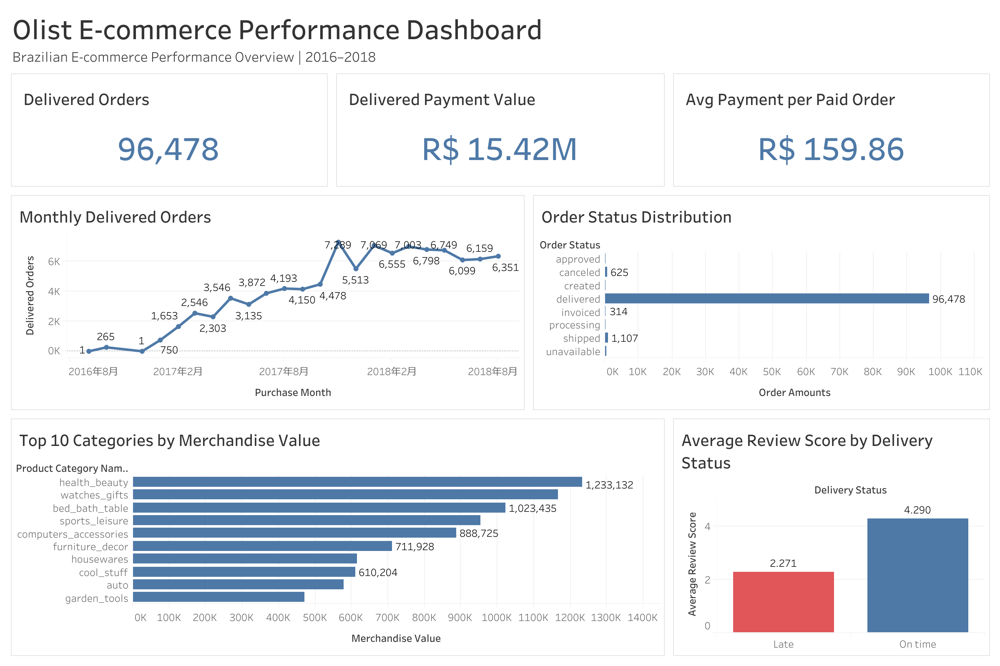

# Olist Brazilian E-Commerce Analysis

## Project Overview

This project analyzes the Brazilian E-Commerce Public Dataset provided by Olist. The dataset contains anonymized commercial order data from Brazilian marketplaces and covers orders recorded between September 2016 and October 2018.

The project demonstrates an end-to-end junior data-analysis workflow using SQL, Python, and Tableau. The analysis begins with data-quality validation and then examines sales performance, customer behavior, product performance, delivery operations, and customer reviews. The final Tableau dashboard brings the main findings together in an interactive business summary.

## Interactive Tableau Dashboard

[View the interactive dashboard on Tableau Public](https://public.tableau.com/shared/63SF9K7W5?:display_count=n&:origin=viz_share_link)



## Business Questions

The project addresses the following questions:

1. What are the main order and payment KPIs?
2. How do order volume and recorded payment value change over time?
3. Which product categories contribute the most sales value?
4. Where are customers and sellers located?
5. How frequently do customers make repeat purchases?
6. How do delivery performance and review scores relate to customer experience?

## Dataset

**Source:** [Brazilian E-Commerce Public Dataset by Olist](https://www.kaggle.com/datasets/olistbr/brazilian-ecommerce)

The dataset contains nine related CSV files:

| Table | Rows | Description |
|---|---:|---|
| `olist_customers_dataset` | 99,441 | Customer identifiers and customer locations |
| `olist_geolocation_dataset` | 1,000,163 | Brazilian postal-code coordinates |
| `olist_order_items_dataset` | 112,650 | Products, sellers, prices, and freight values within orders |
| `olist_order_payments_dataset` | 103,886 | Payment methods, installments, and payment values |
| `olist_order_reviews_dataset` | 99,224 | Review scores, comments, and review dates |
| `olist_orders_dataset` | 99,441 | Order status and purchase, approval, delivery, and estimated dates |
| `olist_products_dataset` | 32,951 | Product categories and product attributes |
| `olist_sellers_dataset` | 3,095 | Seller identifiers and seller locations |
| `product_category_name_translation` | 71 | Portuguese-to-English product-category translations |

The observed order period is **2016-09-04 to 2018-10-17**. The first and last calendar months are incomplete and should not be compared directly with complete months.

## Tools

- **MySQL / DBeaver:** data-quality checks and business analysis
- **Python / Pandas / Google Colab:** exploratory validation and visualization
- **Tableau Public:** relational data model, calculated fields, KPI cards, and interactive dashboard
- **GitHub:** project documentation and reproducible analysis files

## Data Quality Assessment

The following checks have been completed before beginning the business analysis:

- All nine CSV files were imported successfully, and their row counts match the source files.
- Order, customer, product, and seller IDs contain no duplicates.
- The composite keys for order items, payments, and reviews contain no duplicate combinations.
- Critical order identifiers, order statuses, and purchase timestamps contain no missing values.
- Product prices and freight values contain no missing or negative values.
- Payment values and installment fields contain no missing values.
- Review scores contain no missing values and fall within the expected range of 1 to 5.
- All order-item, payment, and review records match an order.
- All order-item records match a product and a seller.

### Identified Data Limitations

- 610 of 32,951 products have no product-category name.
- 13 products across two categories have no English category translation: `pc_gamer` and `portateis_cozinha_e_preparadores_de_alimentos`.
- Nine payment rows have a payment value of zero.
- Two positive credit-card payment rows record zero installments.
- 775 orders have no item records; 767 of these orders are unavailable or canceled, and none are delivered.
- One delivered order has no corresponding payment record.
- 768 orders have no review record, including 646 delivered orders.
- The review table is not one row per order or one row per review ID; the combination of `review_id` and `order_id` uniquely identifies a review row.

## Analytical Decisions

- Original source records are retained; uncertain values are not overwritten or deleted without supporting evidence.
- Orders without item records will not enter product- or category-level analysis.
- The delivered order without a payment record will remain in order counts but cannot contribute to payment-based metrics.
- Missing product categories will be labeled `Unknown` during category analysis.
- Product categories without an English translation will retain their original Portuguese names.
- Zero-installment records will be excluded from installment-specific calculations or identified as unknown.
- Missing reviews will not be assigned a score of zero because no review is different from a negative review.

## SQL Sales Overview

The completed-order analysis uses delivered orders for payment-based performance metrics while retaining all order statuses for operational context.

### Key Findings

- The dataset contains 99,440 orders with payment records and a total recorded payment value of 16,008,872.12.
- There are 96,478 delivered orders; 96,477 have payment records.
- Delivered orders contribute 15,422,461.77, or approximately 96.34% of all recorded payment value.
- Completed-order activity increased substantially during 2017 and remained at a higher level during 2018.
- November 2017 recorded the highest delivered-order volume, with 7,289 orders and a payment value of 1,153,528.05.
- Credit cards contribute approximately 78.46% of delivered-order payment value, followed by boleto at approximately 17.96%.
- One-installment credit-card payments are the most common. Higher-value credit-card payments are more frequently associated with longer installment plans, particularly 8 and 10 installments.
- Installment groups above 10 contain relatively few records and should not be used for strong conclusions.

## SQL Customer Analysis

Customer behavior is analyzed using `customer_unique_id`, which identifies the same shopper across multiple order-level customer records. Repeat-purchase metrics use delivered orders only.

### Key Findings

- The customer table contains 99,441 order-level customer records representing 96,096 unique customers.
- A total of 93,358 unique customers completed 96,478 delivered orders.
- 90,557 customers completed one delivered order, while 2,801 completed more than one.
- The repeat-customer rate is 3.00%, and customers completed an average of 1.03 delivered orders.
- Repeat customers generated 5,921 paid delivered orders and 864,357.21 in recorded payment value.
- Repeat customers averaged 308.59 in cumulative payment value per customer, compared with 160.76 for one-time customers.
- Repeat customers had a lower average payment value per order: 145.98 compared with 160.76 for one-time customers. Their higher cumulative value therefore came from purchase frequency rather than larger individual orders.
- São Paulo accounted for approximately 41.98% of delivered orders and 37.42% of delivered-order payment value.
- Most customers in the top-20 payment-value ranking generated their value from one high-value order rather than repeated purchases.

## SQL Product Analysis

Product performance is analyzed at the order-item level using delivered orders. Merchandise value represents item prices before freight, while freight share compares recorded freight value with the combined merchandise and freight amount.

### Key Findings

- Delivered orders contain 110,197 item rows across 96,478 orders and represent 32,216 distinct products.
- Delivered merchandise value totals 13,221,498.11, with an additional 2,198,275.64 in recorded freight value.
- `health_beauty` generated the highest merchandise value at 1,233,131.72.
- `bed_bath_table` recorded the most delivered orders and item rows among the 15 leading categories, but its average item price was lower than several other leading categories.
- `watches_gifts` generated the second-highest merchandise value and had the highest average item price among the leading 15 categories at 199.04.
- `christmas_supplies` had the highest freight share among categories with at least 100 delivered item rows, at 26.75%, but its sales volume was relatively small.
- `electronics` combined a high freight share of 22.76% with 2,729 delivered item rows.
- `furniture_decor` and `housewares` combined substantial item volume with freight shares above 18%, making them more operationally significant than some smaller categories with higher percentages.
- Freight value is a recorded customer-order amount and is not treated as the seller's actual logistics cost or as evidence of product profitability.

## SQL Delivery and Review Analysis

Delivery performance is measured from purchase to customer receipt. An order is classified as on time when its actual delivery date is on or before its estimated delivery date. Review comparisons first aggregate the review table to one score per order.

### Key Findings

- Of 96,478 delivered orders, 96,470 have an actual customer delivery date. Their average delivery time was 12.09 days.
- The longest recorded delivery time was 209 days. Several extreme records share the same delivery date and are retained with a caution that they may represent exceptional operations or later date entry.
- A total of 89,936 delivered orders were on time and 6,534 were late, producing an on-time delivery rate of 93.23%.
- Five-star reviews accounted for 57.78% of review records, while four- and five-star reviews together accounted for 77.07%.
- Reviewed on-time orders had an average review score of 4.29, compared with 2.27 for reviewed late orders.
- Average review scores fell to 2.72 for orders delayed by 1–7 days and approximately 1.6–1.7 for orders delayed by 8–30 days.
- The relationship between late delivery and lower review scores is an association. Product quality, seller service, and other unobserved factors may also influence customer ratings.

## Python Exploratory Analysis

The [Python notebook](python/01_olist_exploratory_analysis.ipynb) validates the main order counts against the SQL results and presents three focused visual analyses using Pandas, Matplotlib, and Seaborn.

### Visual Findings

- Monthly delivered-order volume increased substantially during 2017, peaked in November 2017, and remained at a higher level during 2018.
- `health_beauty` generated the highest delivered merchandise value, followed by `watches_gifts` and `bed_bath_table`.
- Reviewed on-time orders averaged 4.29 stars, compared with 2.27 for reviewed late orders.
- The notebook uses straightforward filtering, merging, grouping, aggregation, and plotting so that each transformation remains easy to audit.

## Tableau Dashboard

The Tableau dashboard uses relationships between the order, customer, payment, order-item, product, category-translation, and cleaned review tables. Relationships preserve the tables' different levels of detail and reduce the risk of duplicating payment or item values during analysis.

### Dashboard Highlights

- 96,478 orders were delivered.
- Delivered orders generated approximately R$15.42 million in recorded payment value.
- Average payment value was R$159.86 per paid delivered order.
- Monthly delivered-order volume increased substantially through 2017 and peaked in November 2017.
- `health_beauty`, `watches_gifts`, and `bed_bath_table` were the leading categories by delivered merchandise value.
- Reviewed on-time orders averaged 4.29 stars, compared with 2.27 for reviewed late orders.

The dashboard contains KPI cards, an order-status distribution, a monthly delivered-order trend, a top-category comparison, and a delivery-status versus review-score comparison.

## Business Recommendations

1. **Prioritize delivery reliability.** Late deliveries were associated with substantially lower review scores. Operations teams should investigate the routes, sellers, and product groups contributing most frequently to delays.
2. **Monitor freight-heavy, high-volume categories.** `furniture_decor`, `housewares`, and `office_furniture` combined meaningful order volume with relatively high freight shares and may offer opportunities for packaging or logistics improvements.
3. **Develop customer-retention initiatives.** Only 3.00% of purchasing customers placed more than one delivered order. Post-purchase communication, targeted offers, and category-based recommendations may help encourage a second purchase.
4. **Protect the strongest product categories.** `health_beauty`, `watches_gifts`, and `bed_bath_table` generated the highest delivered merchandise values and should receive close attention in inventory, seller-service, and delivery planning.
5. **Treat associations cautiously.** The analysis identifies relationships in observational marketplace data; it does not establish that delivery performance or any other individual factor directly caused customer behavior.

## Repository Structure

```text
ecommerce-data-analysis/
├── README.md
├── python/
│   └── 01_olist_exploratory_analysis.ipynb
├── sql/
│   ├── 00_data_quality_checks.sql
│   ├── 01_sales_overview.sql
│   ├── 02_customer_analysis.sql
│   ├── 03_product_analysis.sql
│   └── 04_delivery_review_analysis.sql
└── tableau/
    ├── Olist_Ecommerce_Dashboard.twb
    ├── Olist_Ecommerce_Dashboard.twbx
    └── olist_ecommerce_dashboard.png
```

## Project Status

- [x] Import and validate the Olist source tables
- [x] Complete the SQL data-quality checks
- [x] Complete the SQL sales overview
- [x] Complete customer analysis
- [x] Complete product analysis
- [x] Complete delivery and review analysis
- [x] Perform Python exploratory analysis
- [x] Build the Tableau dashboard
- [x] Add final business findings and recommendations
- [x] Add the published Tableau Public URL to this README
